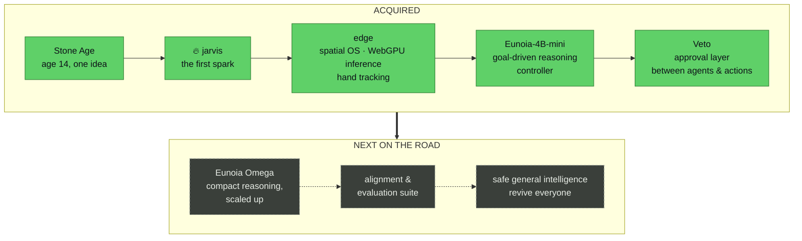

<picture>
  <source media="(prefers-color-scheme: dark)" srcset="./assets/header-dark.svg">
  <source media="(prefers-color-scheme: light)" srcset="./assets/header-light.svg">
  
</picture>

  

  
  
  

### ssup, I'm Shaurya ( Bluber )

At 14 I wanted a machine that could think *alongside* a person: human creativity and judgement, plus machine-scale calculation. I've been building toward it ever since, through papers, models and eventually a company.

Now I run **[SHV Groups](https://shvgroups.com)**, where **Eunoia Labs** researches general intelligence and machine consciousness. The field is drifting toward AI that replaces people. I'm building the other kind: **safe general intelligence that lifts humanity up**. Science is just two million years of humans stacking steps on each other, so I'm stacking mine.

Also: anime enjoyer, professional overthinker, amateur chemist of tensors.

<!-- COUNTER:START -->
**215,435,560** seconds counted since I decided, at 14, to build a machine that thinks alongside us. Senku counted 117,354,893,870. I'm at **0.18%**. Catching up.
<!-- COUNTER:END -->

### The Roadmap

### ACQUIRED!!

- **[Veto](https://github.com/SHVGroups/veto)**: open-source approval layer that sits between AI agents and the actions they take. Decisions come from a typed model, not a generative one. **v1.0 is public.**
- **[Eunoia-4B-mini](https://github.com/Shv-tech/Eunoia-4B-mini)**: ~4B reasoning model with an external cognitive controller (goal hierarchies, step-wise evaluation and retry, adaptive goal mutation). Built on Qwen3-4B, Apache 2.0.
- **[edge](https://github.com/Shv-tech/edge)**: spatial computing and autonomous control layer. WebGPU inference in the browser, a Rust hardware bridge, PyTorch hand tracking.

### Not one millimeter

- chance I ship an AI that replaces the humans it was meant to help
- chance I skip the safety evals because the demo looked cool
- chance I stop watching anime

### Lab equipment

`Python` · `PyTorch` · `Transformers` · `TypeScript` · `Next.js` · `Rust` · `WebGPU`

### Join the Kingdom of Science

Researchers, builders, alignment nerds and fellow weebs: let's build the good timeline.

  
  
  

<picture>
  <source media="(prefers-color-scheme: dark)" srcset="https://raw.githubusercontent.com/Shv-tech/Shv-tech/output/snake-dark.svg">
  <source media="(prefers-color-scheme: light)" srcset="https://raw.githubusercontent.com/Shv-tech/Shv-tech/output/snake-light.svg">
  
</picture>

Every commit stands on two million years of human science. Petrified for now, reviving soon. 🪨→🌱

